<!-- Gerado por scripts/equipe.py a partir de scripts/equipe.json. Não edite à mão. -->

# Equipe

Quem faz o Brasil Participativo, em ordem alfabética: 121 pessoas, entre as registradas na base Integrantes da Equipe, no Notion, e as que contribuíram com código nos repositórios do grupo [`lappis-unb/decidimbr`](https://gitlab.com/lappis-unb/decidimbr), no GitLab. A autoria institucional é do LabLivre/UnB.

A foto vem do GitLab e, quando não há, do Notion. Contatos e outros dados pessoais não são publicados. Lista da página Equipe do portal de conhecimento, gerada em 10/10/2026.

| | Nome | GitLab |
|---|---|---|
| AB | Alexandre Boava | — |
| AP | Ana Paula Tarchetti | [@atarchetti](https://gitlab.com/atarchetti) |
| AE | Anna e só | — |
|  | Arthur Jahn | [@ArthurJahn](https://gitlab.com/ArthurJahn) |
|  | Arthur Lima | [@arthurlima544](https://gitlab.com/arthurlima544) |
|  | Arthur Melo | [@Arthrok](https://gitlab.com/Arthrok) |
|  | Artur Ricardo | [@algorithmorphic](https://gitlab.com/algorithmorphic) |
| AS | Artur Seppa Reiman | [@artur-seppa](https://gitlab.com/artur-seppa) |
| 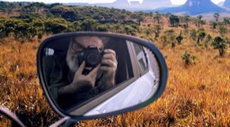 | Blas Eduardo | — |
|  | Breno Yuri | — |
|  | Bruna Pinos | [@brunapinos](https://gitlab.com/brunapinos) |
| 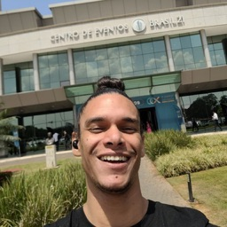 | Caetano Santos | — |
|  | Caio Duarte | [@CaioDuart3](https://gitlab.com/CaioDuart3) |
| CF | Caio Flôres | [@caiocflores](https://gitlab.com/caiocflores) |
|  | Caio Rocha de Oliveira | [@Dexmachi](https://gitlab.com/Dexmachi) |
|  | Carla Rocha | [@rocha.carla](https://gitlab.com/rocha.carla) |
| C | Carol | — |
|  | Carolina Barbosa | [@CarolinaBarb](https://gitlab.com/CarolinaBarb) |
| 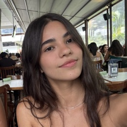 | Cibelly Lourenço | [@cibelinda](https://gitlab.com/cibelinda) |
|  | Cristiane Naves Cardoso | [@CristianeNaves](https://gitlab.com/CristianeNaves) |
| 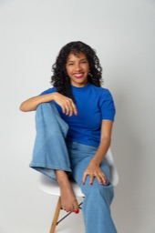 | Dalva Santos | — |
|  | Daniela s oliveira | [@daniela0412](https://gitlab.com/daniela0412) |
|  | Danielle Soares | [@silvasoaresdanielle2](https://gitlab.com/silvasoaresdanielle2) |
|  | David Carlos | [@davidCarlos](https://gitlab.com/davidCarlos) |
|  | Diego Dorgam | [@diegodorgam](https://gitlab.com/diegodorgam) |
| D | dudaa28 | — |
|  | Eduardo Nunes | [@Edu_25](https://gitlab.com/Edu_25) |
|  | Eric Silveira | [@eric.bky](https://gitlab.com/eric.bky) |
| FB | Fernando Blat | — |
| FF | Francisco Ferreira | [@francisco1code](https://gitlab.com/francisco1code) |
| GC | Gabriel Costa de Oliveira | — |
| GS | Gabriel Sabanai | — |
|  | Gabriel Scheidt | [@Gxaite](https://gitlab.com/Gxaite) |
|  | Gabriel Zaranza | [@GZaranza](https://gitlab.com/GZaranza) |
|  | Gabriela Alves | [@gaubiela](https://gitlab.com/gaubiela) |
|  | Genilson Silva De Araújo Junior | [@GenilsonJrs](https://gitlab.com/GenilsonJrs) |
|  | Geovane Freitas | [@GeovaneSFT](https://gitlab.com/GeovaneSFT) |
| GA | Giovanni Alvissus | — |
|  | Giovanni Giampauli | [@giovanniacg](https://gitlab.com/giovanniacg) |
|  | Gisele Pimenta | — |
|  | Guilherme Barbosa Ferreira | [@guibrbs1](https://gitlab.com/guibrbs1) |
| GC | Guilherme Carballal | — |
|  | Guilherme Daniel Fernandes da Silva | [@guilhermedfs14](https://gitlab.com/guilhermedfs14) |
| GG | Guilherme Gusmão Nepomuceno | [@guilhermegusmao](https://gitlab.com/guilhermegusmao) |
| GG | Gustavo Gontijo | [@Guga301104](https://gitlab.com/Guga301104) |
|  | Gustavo Henrique | [@gustavohenriqueprivado](https://gitlab.com/gustavohenriqueprivado) |
|  | Hadrien Froger | [@hadrien_froger](https://gitlab.com/hadrien_froger) |
|  | Isaque Alves | [@alvesisaque](https://gitlab.com/alvesisaque) |
| J | Joao | — |
|  | João Egewarth | [@egewarth](https://gitlab.com/egewarth) |
|  | João Guilherme | [@joaaogui](https://gitlab.com/joaaogui) |
| JN | Joao Nobrega | [@bot-do-jao](https://gitlab.com/bot-do-jao) |
|  | João Pedro Amoêdo | [@joao-amoedo](https://gitlab.com/joao-amoedo) |
|  | Joyce Dionizio | [@joyce.jdm](https://gitlab.com/joyce.jdm) |
|  | Juan Pablo | [@Juan-Ricarte](https://gitlab.com/Juan-Ricarte) |
| 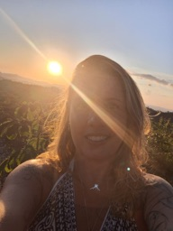 | Juliana | — |
|  | Kizia Fonseca | — |
| LU | Lablivre UnB | — |
| LV | Lana Vitória | — |
|  | Larissa Gomes Silva | [@larigs](https://gitlab.com/larigs) |
|  | Laura Pinos | [@laurapinos](https://gitlab.com/laurapinos) |
|  | Leonardo da Silva Gomes | [@LeoSilvaGomes](https://gitlab.com/LeoSilvaGomes) |
|  | Leonardo Lago Moreno | [@LeLaMo](https://gitlab.com/LeLaMo) |
|  | Leonardo M. Miranda | [@leomichalski](https://gitlab.com/leomichalski) |
| LH | Letícia Hladczuk | [@hladczukle](https://gitlab.com/hladczukle) |
| L | Loana | — |
| LG | Luan Guimarães | — |
| 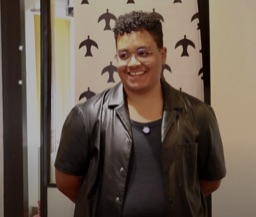 | Lucas Guimarães | — |
| LM | Lucas Maretti | [@lucas.maretti](https://gitlab.com/lucas.maretti) |
|  | Lucas Pirola | [@lpirola](https://gitlab.com/lpirola) |
|  | Lucas Sousa | — |
|  | Lucca Medeiros | [@luccameds](https://gitlab.com/luccameds) |
| 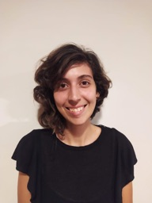 | Luiza Davison | — |
|  | Maicon Mares | [@maiconmares](https://gitlab.com/maiconmares) |
| MF | Manoel Felipe | [@Manoel835](https://gitlab.com/Manoel835) |
|  | Marcus Martins | [@marcusmartinss](https://gitlab.com/marcusmartinss) |
| 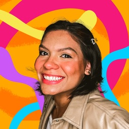 | Maria Clara Guimarães | — |
|  | Maria Eduarda | [@eduardaq2805](https://gitlab.com/eduardaq2805) |
| MV | Maria Vitoria Duarte | — |
| 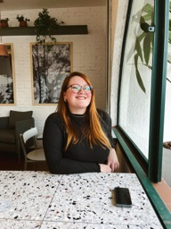 | Marina Alves | — |
| 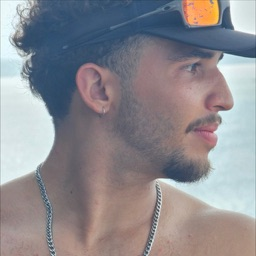 | Mateus Cavalcante | — |
|  | Mateus de Castro | [@mat054](https://gitlab.com/mat054) |
| MC | Matheus Carvalho | [@math_scarvalho](https://gitlab.com/math_scarvalho) |
| MM | Matheus Miranda | [@MatheusMiranda](https://gitlab.com/MatheusMiranda) |
|  | Matheus Moreira Beltrami | [@MBeltrami_dex](https://gitlab.com/MBeltrami_dex) |
| 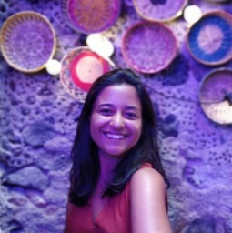 | Mayara Faria | — |
|  | Miguel Arthur | [@zlimaz](https://gitlab.com/zlimaz) |
| 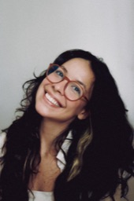 | Nathalia Feitosa | — |
| PD | Participa Dev | — |
| 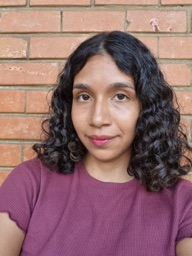 | Paula Ribeiro | — |
|  | Paulo Gonçalves Lima | [@PauloGoncalvesLima](https://gitlab.com/PauloGoncalvesLima) |
|  | Paulo Tada | [@paulohtfs](https://gitlab.com/paulohtfs) |
| 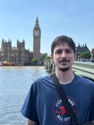 | Pedro Burity | — |
| 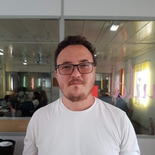 | Poppi | — |
| RB | Rafael Bosi | [@StrangeUnit28](https://gitlab.com/StrangeUnit28) |
| RD | Rafael De Toni | — |
| RF | Ranielder Freitas | — |
| R | Raphael | — |
|  | Raquel Eucaria | [@raqueleucaria](https://gitlab.com/raqueleucaria) |
| RC | Renam C. da Silva | — |
|  | Renan Girão | [@RenanGirao](https://gitlab.com/RenanGirao) |
|  | Renato Sampaio | [@renatocoral](https://gitlab.com/renatocoral) |
| RC | Roddas Cabral | — |
|  | Rodolfo Neves | [@roddas](https://gitlab.com/roddas) |
|  | Ronivaldo Júnior | [@junhfer](https://gitlab.com/junhfer) |
| SH | Sandro Haddad | — |
| SG | Sérgio Granemann | — |
|  | Suzane Duarte | [@ssuzane9](https://gitlab.com/ssuzane9) |
|  | Thais Rebouças de Araujo | [@Thais-ra](https://gitlab.com/Thais-ra) |
|  | Thalita Quelita | — |
|  | Victor Jorge da Silva Gonçalves | [@VictorJorgeFGA](https://gitlab.com/VictorJorgeFGA) |
| VO | Vinicius Oliveira | [@ViniciussdeOliveira](https://gitlab.com/ViniciussdeOliveira) |
|  | Vinícius Ribeiro | [@viniiribeiro](https://gitlab.com/viniiribeiro) |
| VB | Vitor Bellini | — |
|  | Vitor Borges | [@VitorB2002](https://gitlab.com/VitorB2002) |
| VF | Vitória Ferrari | — |
|  | Wildemberg Sales | [@wildemberg-sales](https://gitlab.com/wildemberg-sales) |
|  | William Bernardo | [@WillxBernardo](https://gitlab.com/WillxBernardo) |
|  | Wolfgang Stein | [@Wolffstein](https://gitlab.com/Wolffstein) |
|  | Yan Guimarães | [@yanzin00](https://gitlab.com/yanzin00) |
| YR | Yuri Ricarte | — |
